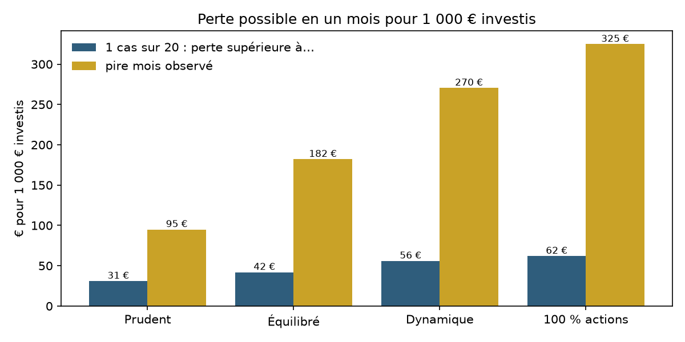
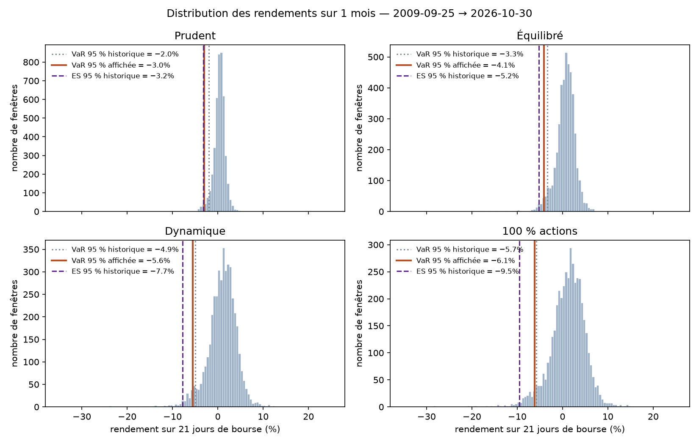

# Spécification de l'indicateur de risque grand public

*Livrable du périmètre minimal (spécification) et bonus (calcul Python) · version 1 · horizon et niveau de confiance à valider en séance 2*

## 1. La phrase affichée

> **Dans 1 cas sur 20, vous pourriez perdre plus de X € en un mois.**

Elle est **toujours** accompagnée de :

1. un **pictogramme de 20 mois** dont 1 est coloré ;
2. la ligne : *« Les 19 autres mois : une perte plus petite, ou un gain. »* ;
3. un encadré **« Ce n'est pas une perte maximale »** donnant le pire mois observé en euros ;
4. la mention : *« Calculé à partir des cours réels de [période]. Les performances passées ne préjugent pas des performances futures. »*

**Formulations interdites** (contresens qu'elles induisent) :

| Formulation interdite | Contresens |
|---|---|
| « Vous ne perdrez pas plus de X € » / « perte maximale » | La VaR n'est pas un maximum (le pire mois observé vaut 3 à 5 fois X) |
| « Vous allez perdre X € un mois sur 20 » | Fréquence moyenne, pas un calendrier |
| « Risque de 5 % » | Confusion entre la probabilité et le montant |
| « 19 mois sur 20 vous gagnez » | Les 19 autres mois peuvent aussi être en perte |

## 2. Définition

Soit $V_t$ la valeur du portefeuille et $R_{t,h} = V_{t+h}/V_t - 1$ son rendement sur $h$ jours de bourse. La **valeur en risque** (Value at Risk, VaR) au niveau $\alpha$ et à l'horizon $h$ est la perte qui n'est dépassée qu'avec une probabilité $1-\alpha$ :

$$\text{VaR}_{\alpha,h} = -\,q_{1-\alpha}\left(R_{t,h}\right), \qquad X = \text{VaR}_{\alpha,h} \times \text{montant investi}$$

où $q_{1-\alpha}$ est le quantile d'ordre $1-\alpha$. Avec $\alpha = 95\,\%$ : $P(\text{perte} > X) = 5\,\% = 1/20$.

## 3. Paramètres proposés et justification

| Paramètre | Proposition | Pourquoi |
|---|---|---|
| **Niveau de confiance** | **95 %** | « 1 cas sur 20 » est une fréquence que l'on se représente : environ un mois sur 20, soit un peu moins d'une fois tous les deux ans. À 99 % (« 1 sur 100 », une fois tous les 8 ans), l'événement paraît abstrait et l'estimation repose sur trop peu d'observations (12 fenêtres sur 5 ans, soit un ou deux épisodes indépendants). |
| **Horizon** | **1 mois (21 jours de bourse)** | C'est le rythme du budget et du relevé bancaire. 1 jour : chiffre trop petit, il banalise le risque et pousse à surveiller. 1 an : trop peu de périodes indépendantes pour estimer un quantile à 5 %. |
| **Méthode** | **VaR historique** (simulation historique) | Elle s'explique en une phrase (« voici ce qui s'est réellement passé ») et ne suppose pas que les rendements suivent une loi normale. |
| **Données** | Cours de clôture **ajustés** (dividendes, opérations sur titres) depuis le 25/09/2009 (première date commune), gel au 30/10/2026 | Fonds indiciels largement diffusés, en euros. Voir §4. |
| **Fenêtres** | Rendements sur 21 jours **glissants** (chevauchants) : 4 357 fenêtres | Exploite toute l'information. L'autocorrélation qui en résulte est traitée dans le backtest, qui utilise des mois **non chevauchants**. |
| **Rééquilibrage** | Retour aux poids cibles le 1er jour de bourse de chaque mois | Correspond à un portefeuille modèle réaliste. |
| **Règle de prudence** | **X = max(VaR sur tout l'historique ; VaR sur les 5 dernières années)** | Le backtest (§6) montre que l'historique complet seul **sous-estime** le risque du portefeuille Prudent depuis 2022. Une fenêtre de 5 ans de données est aussi la convention de calcul du risque de marché des DIC PRIIPs. |
| **Arrondi** | **Par excès** à 2 chiffres significatifs (30,07 € → 31 €) | On n'affiche jamais une perte inférieure au calcul. Le chiffre reste lisible. |
| **Mise à jour** | Mensuelle | Le chiffre est vivant ; l'utilisateur est prévenu qu'il peut changer. |

## 4. Portefeuilles types (proposition pour la séance 1)

| Portefeuille | Actions monde | Obligations d'États zone euro | Monétaire euro |
|---|---|---|---|
| **Prudent** | 20 % | 60 % | 20 % |
| **Équilibré** | 50 % | 40 % | 10 % |
| **Dynamique** | 80 % | 20 % | — |
| **100 % actions** | 100 % | — | — |

| Classe d'actifs (affichage) | Donnée utilisée (source : Yahoo Finance via `yfinance`) |
|---|---|
| Actions monde (indice MSCI World) | `IWDA.AS`, iShares Core MSCI World UCITS ETF, en EUR |
| Obligations d'États zone euro | `XGLE.DE`, Xtrackers II Eurozone Government Bond UCITS ETF, en EUR |
| Monétaire euro | `XEON.DE`, Xtrackers II EUR Overnight Rate Swap UCITS ETF, en EUR |
| *Test de résistance 2008 uniquement* | `EXSA.DE`, iShares STOXX Europe 600 (proxy actions, car `IWDA.AS` débute en 2009) |

Les noms commerciaux des fonds ne sont **pas** affichés dans l'application (voir page réglementaire). On n'affiche que la classe d'actif et l'indice.

## 5. Méthode de calcul pas à pas

1. Télécharger les cours ajustés et les **geler** dans `python/donnees/prix.csv`.
2. Aligner les places (Amsterdam / Francfort) : report du dernier cours connu, 5 jours au plus (72 valeurs comblées, aucune ligne supprimée).
3. Construire la valeur quotidienne de chaque portefeuille, rééquilibré chaque mois.
4. Calculer les 4 357 rendements sur 21 jours glissants.
5. Calculer le quantile à 5 % (interpolation linéaire, `numpy.quantile`) sur **tout l'historique** et sur les **5 dernières années** (1 240 fenêtres) ; retenir le plus élevé des deux.
6. Multiplier par le montant virtuel et arrondir par excès à 2 chiffres significatifs.
7. Calculer les compléments affichés : pire mois observé (21 jours) et les 20 groupes de même taille (vingtiles) pour le graphique « Comprendre ».

Code : `python/var_indicateur.py`. Relance reproductible sans réseau : `python var_indicateur.py --offline`.

## 6. Résultats (données arrêtées au 30/10/2026)

| Portefeuille | VaR historique (2009-2026) | VaR 5 ans | **VaR affichée** | **X pour 1 000 €** | **X pour 10 000 €** | Pire mois observé | Perte moyenne au-delà de la VaR (ES 95 %, historique) |
|---|---|---|---|---|---|---|---|
| Prudent | 2,00 % | 3,01 % | **3,01 %** | **31 €** | **310 €** | −9,5 % (févr.–mars 2020) | 3,2 % |
| Équilibré | 3,31 % | 4,10 % | **4,10 %** | **42 €** | **420 €** | −18,2 % (févr.–mars 2020) | 5,2 % |
| Dynamique | 4,93 % | 5,56 % | **5,56 %** | **56 €** | **560 €** | −27,1 % (févr.–mars 2020) | 7,7 % |
| 100 % actions | 5,74 % | 6,13 % | **6,13 %** | **62 €** | **620 €** | −32,5 % (févr.–mars 2020) | 9,5 % |

Phrase affichée pour 10 000 € en portefeuille Dynamique : *« Dans 1 cas sur 20, vous pourriez perdre plus de 560 € en un mois. »* et, juste en dessous : *« Le pire mois depuis 2009 (févr.–mars 2020), ce portefeuille a perdu 2 705 €. »*

## 7. Validation scientifique

**Contrôle croisé paramétrique.** Une VaR gaussienne (moyenne et écart-type journaliers, règle de la racine du temps) donne 1,76 % / 3,14 % / 4,88 % / 6,10 %, proche de la VaR historique à 95 %. L'écart se creuse dans la queue de distribution : la perte moyenne au-delà de la VaR (ES) vaut environ 1,6 fois la VaR historique, et le pire mois 5 à 6 fois. **C'est pourquoi le pire mois est toujours affiché.**

**Backtest hors échantillon.** À chaque date de test (148 mois non chevauchants, de 2014 à 2026), on estime la VaR **avec la même fonction que le chiffre affiché**, en n'utilisant que les cours connus à cette date, puis on la compare à la perte du mois suivant. Attendu : 5 % de dépassements.

| Portefeuille | Méthode affichée (règle de prudence) | Kupiec (p) | Christoffersen (p) | *Variante : historique seul* |
|---|---|---|---|---|
| Prudent | 11/148 = 7,4 % | 0,20 ✅ | 0,035 ⚠️ | *10,1 %, p = 0,011 ❌* |
| Équilibré | 11/148 = 7,4 % | 0,20 ✅ | 0,22 ✅ | *8,1 %, p = 0,11* |
| Dynamique | 11/148 = 7,4 % | 0,20 ✅ | 0,22 ✅ | *7,4 %, p = 0,20* |
| 100 % actions | 9/148 = 6,1 % | 0,56 ✅ | 0,56 ✅ | *6,8 %, p = 0,35* |

- Le test de Kupiec (nombre de dépassements) **n'est rejeté pour aucun portefeuille** avec la règle de prudence, alors qu'il l'est pour le Prudent avec l'historique seul. C'est ce constat qui a motivé la règle.
- Le test de Christoffersen signale pour le Prudent des dépassements **groupés en 2022** (hausse des taux : actions et obligations ont baissé ensemble). Limite connue de la VaR historique, qui réagit lentement aux changements de régime. Le taux de dépassement reste au-dessus de 5 % pour tous : à discuter en relecture croisée.

**Test de résistance 2008** (hors période de calcul, proxy actions européennes) : pire mois de 4,7 % / 12,9 % / 20,9 % / 26,4 %. C'est moins que mars 2020 pour les 4 portefeuilles : la période retenue contient donc déjà un choc au moins aussi sévère.

**Sensibilité à la fenêtre d'estimation** (`resultats/sensibilite.csv`) : sur 3 ans, la VaR serait plus faible (Prudent 1,67 %) ; sur 10 ans, intermédiaire (2,40 %). Le chiffre dépend donc de la période. La règle de prudence prend le plus élevé de deux fenêtres fixées **à l'avance**, sans optimiser la fenêtre sur le backtest.

## 8. Limites assumées (et dites à l'utilisateur)

| Limite | Comment elle est traitée |
|---|---|
| Le passé ne prévoit pas l'avenir | Mention obligatoire ; « Ce n'est pas une prévision » dans l'écran Comprendre ; question 2 du quiz |
| La VaR ne dit rien de l'ampleur au-delà du seuil | Pire mois affiché sous la phrase ; perte moyenne du « 1 cas sur 20 » dans le graphique |
| 17 ans de données, pas de crise de 2008 dans la période | Test de résistance 2008 documenté ; mars 2020 plus sévère |
| Réaction lente aux changements de régime | Règle de prudence (5 ans) ; recalcul mensuel |
| Frais, fiscalité et inflation non pris en compte | À ajouter en V2 (feuille de route) |

## 9. Critère d'acceptation lié

Au moins **2 utilisateurs test sur 3** doivent interpréter correctement la phrase, selon la grille de `06_protocole_test_utilisateurs.md` : idée de **fréquence** (environ 1 mois sur 20) **et** idée que la perte **peut dépasser X**, sans contresens « maximum » ni « certitude ».
